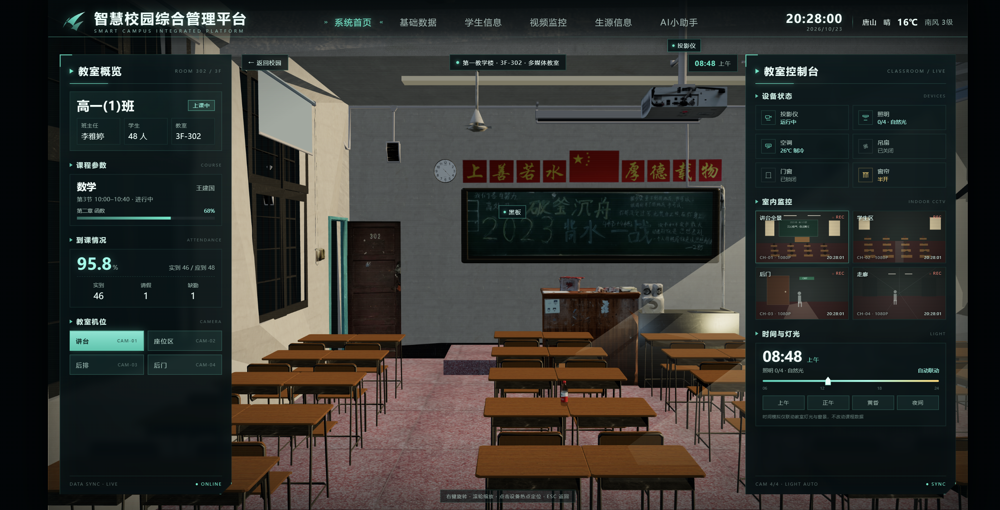

# School Vista 3D · 智慧校园 3D 平台

> 用 React + React Three Fiber 在浏览器中还原智慧校园数字孪生：3D 校园、科技感 HUD、数据面板与 AI 助手。



> 教室模式：3D 教室内景、左侧班级概览、右侧教室控制台与四路室内监控。

## 当前状态

- **工程骨架已落地**：Vite + React + TypeScript + three / R3F / drei，1920×1080 等比舞台、顶部导航、左侧工具栏、右侧数据面板、实时时钟。
- **校园外景**：双教学楼、操场与 6 个占位建筑按 `src/data/layout.json` 摆放，支持 POI 标签、详情卡、13 个室外机位、加载进度和性能读数。
- **教室模式**：从「地点建筑 → 教室内」进入，教室 GLB 按需加载，提供 4 个室内机位、设备热点、班级概览、教室控制台、四路室内监控与时间/灯光联动。
- **原型仍保留**：`docs/智慧校园3D平台_原型资料/prototype.html` 是交互与视觉参考，不是最终技术栈。

详细方案见 [docs/项目开发方案.md](docs/项目开发方案.md)，资产规范见 [docs/Blender三维资产接入方案.md](docs/Blender三维资产接入方案.md)。

## 快速开始

```bash
npm install
npm run dev
```

打开 http://127.0.0.1:5173/。

常用命令：

| 命令 | 说明 |
| --- | --- |
| `npm run dev` | 启动开发服务器 |
| `npm run build` | 类型检查 + 生产构建 |
| `npm run preview` | 预览生产构建 |
| `npm run measure` | 输出 GLB 包围盒、锚点、材质统计 |
| `npm run verify:ui` | 无头浏览器截图与交互验证 |

`verify:ui` 默认查找本机 Chrome / Edge，也可通过 `CHROME_PATH` 指定可执行文件。

## 目录结构

```text
.
├─ src/
│  ├─ scene/                 # R3F 场景、模型加载、POI、相机、性能探针
│  ├─ ui/                    # HUD、面板、POI 卡片、加载遮罩
│  ├─ stage/                 # 1920×1080 等比舞台
│  ├─ store/                 # Zustand 状态
│  ├─ data/layout.json       # 布局冻结（模型、POI、相机、道路）
│  ├─ types/                 # 布局类型
│  └─ styles/                # 全局 token 与重置样式
├─ public/assets/
│  ├─ campus/                # 教学楼群、操场
│  └─ interior/              # 教室
├─ tools/
│  ├─ asset-pipeline/        # GLB 实测脚本
│  └─ verify/                # 无头浏览器验证
├─ docs/                     # 原型资料、资产方案、项目开发方案、界面截图
├─ model/                    # Blender 源文件与原始贴图
└─ README.md
```

## 技术栈

- Vite + React + TypeScript
- three + `@react-three/fiber` + `@react-three/drei`
- Zustand
- CSS Modules + CSS Variables
- Blender + glTF 2.0 + gltf-transform + Meshopt
- ECharts、hls.js / flv.js（后续面板与监控接入）

## 资产与预算

| 资产 | 文件 | 体积 | 三角面 | draw call |
| --- | --- | --- | --- | --- |
| 第一教学楼 | `public/assets/campus/teaching-1.glb` | 4.89MB | 72,274 | 10 |
| 第二教学楼 | `public/assets/campus/teaching-2.glb` | 2.81MB | 47,056 | 8 |
| 操场 | `public/assets/campus/playground.glb` | 4.18MB | 43,290 | 12 |
| 教室 | `public/assets/interior/classroom.glb` | 9.68MB | 92,722 | 58 |

- 1 单位 = 1 米，Y 轴向上，地面 `y = 0`。
- 外景合计 11.88MB / 16.3 万面 / 30 draw call。
- 教室按需加载，不占首屏。

## 说明

- `model/` 中的 Blender 场景与贴图为源资产，公开部署前需确认素材授权。
- AI 面板当前为骨架占位；接入真实接口时通过服务端 BFF 代理，避免在前端暴露 API Key。
