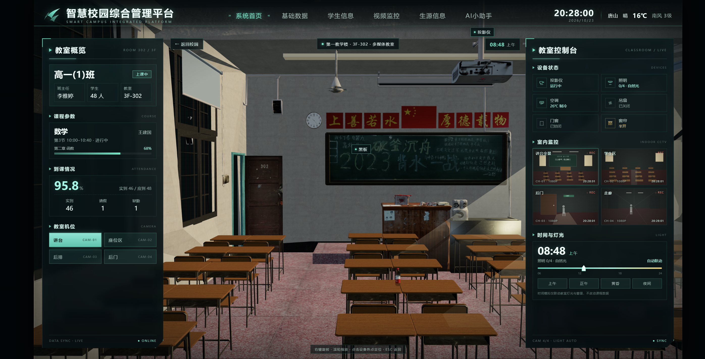

# School Vista 3D · 智慧校园 3D 平台

> 用 React + React Three Fiber 在浏览器中还原智慧校园数字孪生：3D 校园、科技感 HUD、数据面板与 AI 助手。



> 教室模式：3D 教室内景、左侧班级概览、右侧教室控制台与四路室内监控。

## 当前状态

- **工程骨架已落地**：Vite + React + TypeScript + three / R3F / drei，全屏多分辨率 HUD、顶部导航、左侧工具栏、右侧数据面板、实时时钟。
- **多分辨率大屏**：以 1920×1080 为设计基准，使用 vw/vh 派生单位与 SCSS 转换函数，覆盖 1366×768 至 15360×4320、21:9 与 32:9；3D 支持档位渲染、像素预算与自适应 dpr。
- **校园外景**：双教学楼、操场与 6 个占位建筑按 `src/data/layout.json` 摆放，支持 POI 标签、详情卡、13 个室外机位、加载进度和性能读数。
- **数据面板**：安保、学生、生源、视频、AI 面板使用 mock 数据；出勤折线与教师 / 性别环形图已接入 ECharts，并随分辨率档位重建字号。
- **教室模式**：从「地点建筑 → 教室内」进入，教室 GLB 按需加载，提供 4 个室内机位、设备热点、班级概览、教室控制台、四路室内监控与时间/灯光联动。
- **原型仍保留**：`docs/智慧校园3D平台_原型资料/prototype.html` 是交互与视觉参考，不是最终技术栈。

详细方案见 [docs/项目开发方案.md](docs/项目开发方案.md)，资产规范见 [docs/Blender三维资产接入方案.md](docs/Blender三维资产接入方案.md)。

## 快速开始

```bash
npm install
npm run dev
```

打开 http://127.0.0.1:5173/。

常用命令：

| 命令 | 说明 |
| --- | --- |
| `npm run dev` | 启动开发服务器 |
| `npm run build` | 类型检查 + 生产构建 |
| `npm run preview` | 预览生产构建 |
| `npm run measure` | 输出 GLB 包围盒、锚点、材质统计 |
| `npm run verify:ui` | 无头浏览器截图与交互验证 |
| `npm run verify:ui:matrix` | 多分辨率验证矩阵，截图与报告写入 `.workbuddy/verify-matrix` |
| `npm run verify:perf` | 10 万 / 100 万点图表性能基准，报告写入 `.workbuddy/perf-benchmark` |

上述 `verify` 命令都需要先启动 `npm run dev`，默认查找本机 Chrome / Edge，也可通过 `CHROME_PATH` 指定可执行文件。

## 多分辨率适配

以 1920×1080 为设计基准，采用 vw/vh 派生单位而非整页 `transform: scale()`：

- `--u = min(100vw / 1920, 100vh / 1080)`：字号、间距、图标、边框统一等比缩放；`--u-vw`、`--u-vh` 用于单轴铺满。
- `src/styles/_responsive.scss` 提供 `u() / vw() / vh() / hairline()`，SCSS 中直接按设计稿像素书写。
- 全屏壳层替代固定 1920×1080 舞台；`data-layout="wide"` / `"ultra"` 驱动 21:9、32:9 的面板加宽与导航间距。
- ECharts 通过 `chartMetrics()` 按档位计算字号，`ResizeObserver` 跟随容器；档位或布局变化时重建 option。
- 3D 渲染按物理像素判定档位：1080P / 2K / 4K 全分辨率；8K 默认 0.75 渲染比例；16K 受 20MP 像素预算约束；8K 阴影贴图降至 1024。
- 自适应画质：5s 预热、2s 采样，低于 28fps 降档、高于 50fps 升档；可在设置面板关闭。

| 视口 | 渲染 DPR | 3D buffer |
| --- | --- | --- |
| 1920×1080 | 1.00 | 1920×1080 |
| 3840×2160 | 1.00 | 3840×2160 |
| 3840×2160 @dpr2 | 1.50 | 5760×3240 |
| 7680×4320 | 0.75 | 5760×3240 |
| 15360×4320 | 0.55 | 8432×2371 |

```bash
npm run verify:ui:matrix
```

覆盖 1366×768 / 1920×1080 / 2560×1440 / 3440×1440 / 3840×2160 / 3840×2160@2x / 5120×1440 / 7680×4320 / 15360×4320，断言溢出、HUD 尺寸、3D buffer、ECharts canvas、导航与 POI 交互。报告写入 `.workbuddy/verify-matrix/report.json`。

## 大数据图表性能基线

`bench.html` 是独立于主应用的性能基准页，用固定种子生成 10 万 / 100 万点，支持四种模式：

- `plain`：全量数据直接 `setOption`，当前基线；
- `lttb`：ECharts 内部 `sampling: 'lttb'`；
- `presample`：主线程先 LTTB 降到 4,000 点，再交给 ECharts；
- `progressive`：`progressive: 2000` + `progressiveThreshold: 5000`。

记录首图可见耗时、ECharts `finished` 耗时、`setOption` 耗时、DataZoom 交互 FPS、longtask 和 CDP JS 堆峰值。

```bash
npm run verify:perf
```

| 数据点 | 模式 | 首图可见 | ECharts 完成 | 导航起首图 | 交互 FPS | 长任务（总 / 交互阶段） | JS 堆峰值 |
| --- | --- | --- | --- | --- | --- | --- | --- |
| 10 万 | plain | 228ms | 164ms | 316ms | 63.2 | 2 / 0 | 57.7MB |
| 10 万 | lttb | 275ms | 267ms | 566ms | 117.8 | 1 / 0 | 42.4MB |
| 10 万 | presample | 161ms | 151ms | 452ms | 119.6 | 1 / 0 | 28.2MB |
| 10 万 | progressive | 367ms | 356ms | 676ms | 36.2 | 1 / 0 | 45.0MB |
| 100 万 | plain | 1894ms | 1860ms | 2360ms | 3.7 | 13 / 12 | 201.2MB |
| 100 万 | lttb | 1555ms | 1527ms | 1970ms | 38.3 | 3 / 2 | 108.2MB |
| 100 万 | presample | 136ms | 128ms | 565ms | 119.4 | 1 / 0 | 28.2MB |
| 100 万 | progressive | 1704ms | 1689ms | 2096ms | 5.8 | 20 / 19 | 192.3MB |

测试条件：Headless Chrome 156、1280×600、dpr 1；FPS 在 20% 可视窗口连续 `dataZoom` 平移下采样，无头环境 rAF 可能超过 60，按相对值比较。长任务包含首屏同步任务，交互阶段为首次可见后的 longtask。

结论：

- 100 万点交给 ECharts 前先 LTTB 到约 4,000 点是当前最优解：首图 136ms、交互阶段无 longtask、堆峰值 28.2MB。
- ECharts 内部 `sampling: 'lttb'` 能改善交互 FPS，但仍保留全量数据，首图约 1.5s、堆峰值 108MB。
- 当前单折线场景下 `progressive` 没有明显收益，不作为主方案。
- 后续应把预降采样接到真实数据管线；Worker 优先用于清洗、聚合、排序等业务计算，LTTB 本身在 100 万点约 13ms，单独为它引入 Worker/WASM 收益有限。WebGL 仍保留给“必须展示全部点”或稠密散点场景。

报告与截图写入 `.workbuddy/perf-benchmark/`，可用 `mode` 参数单独复测：

```text
http://127.0.0.1:5173/bench.html?points=1000000&mode=presample&sample=4000&fpsMs=3000
```

## 目录结构

```text
.
├─ bench.html                # 图表性能基准页（Canvas 2D 基线）
├─ src/
│  ├─ benchmark/             # 10 万 / 100 万点数据集与性能采样
│  ├─ config/                # 分辨率档位、渲染预算、图表 metrics
│  ├─ scene/                 # R3F 场景、模型加载、POI、相机、性能探针
│  ├─ ui/                    # HUD、面板、ECharts 图表、POI 卡片
│  ├─ utils/                 # 视口单例、dpr 跟随
│  ├─ store/                 # Zustand 状态
│  ├─ data/layout.json       # 布局冻结（模型、POI、相机、道路）
│  ├─ types/                 # 布局类型
│  └─ styles/                # global.scss + _responsive.scss 转换函数
├─ public/assets/
│  ├─ campus/                # 教学楼群、操场
│  └─ interior/              # 教室
├─ tools/
│  ├─ asset-pipeline/        # GLB 实测脚本
│  └─ verify/                # UI、分辨率矩阵、图表性能基准
├─ docs/                     # 原型资料、资产方案、项目开发方案、界面截图
├─ model/                    # Blender 源文件与原始贴图
└─ README.md
```

## 技术栈

- Vite + React + TypeScript
- three + `@react-three/fiber` + `@react-three/drei`
- Zustand
- CSS Modules + SCSS + CSS Variables
- ECharts 6（按需引入 + canvas 渲染）
- Blender + glTF 2.0 + gltf-transform + Meshopt
- hls.js / flv.js（视频监控后续接入）

## 资产与预算

| 资产 | 文件 | 体积 | 三角面 | draw call |
| --- | --- | --- | --- | --- |
| 第一教学楼 | `public/assets/campus/teaching-1.glb` | 4.89MB | 72,274 | 10 |
| 第二教学楼 | `public/assets/campus/teaching-2.glb` | 2.81MB | 47,056 | 8 |
| 操场 | `public/assets/campus/playground.glb` | 4.18MB | 43,290 | 12 |
| 教室 | `public/assets/interior/classroom.glb` | 9.68MB | 92,722 | 58 |

- 1 单位 = 1 米，Y 轴向上，地面 `y = 0`。
- 外景合计 11.88MB / 16.3 万面 / 30 draw call。
- 教室按需加载，不占首屏。

## 说明

- `model/` 中的 Blender 场景与贴图为源资产，公开部署前需确认素材授权。
- AI 面板当前为骨架占位；接入真实接口时通过服务端 BFF 代理，避免在前端暴露 API Key。
