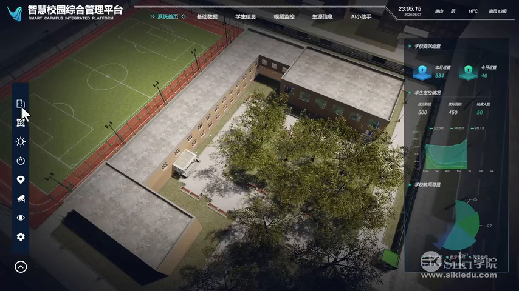
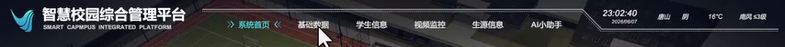
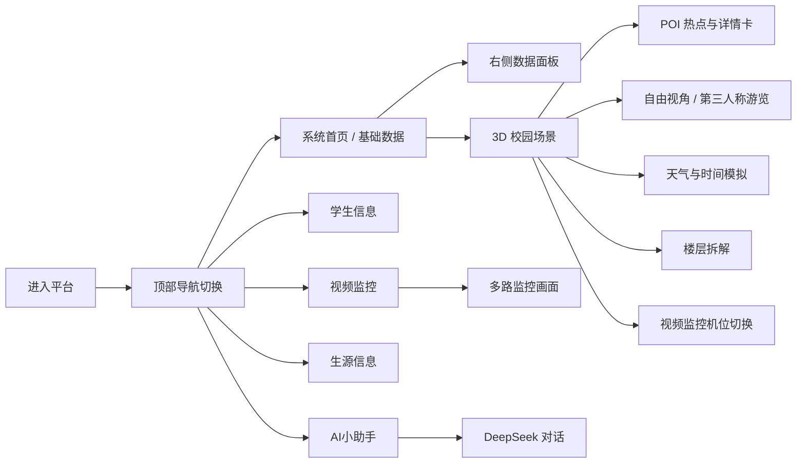

# 智慧校园 3D 平台 · 视频拆解与网页复刻原型资料

| 项目 | 内容 |
| --- | --- |
| 视频标题 | 从零做智慧校园3D平台｜Unity数字孪生项目实战教学 |
| 视频链接 | https://www.bilibili.com/video/BV1KbgA67EjN/ |
| UP 主 | siki学院-小初老师 |
| 发布时间 | 2026-08-14 |
| 视频结构 | 34 个分 P，总时长约 4 小时 58 分（17,900 秒） |
| 主要依据 | P1「00-项目演示」2:37（无旁白）、P2「01-项目讲解」2:38、P26/P28/P31/P33 界面制作片段 |
| 用途 | 用 React + React Three Fiber + Three.js 复刻为网页端智慧校园数字孪生平台 |

> 视频源仅能获取 480p（854×480）画质，全屏截图保持原尺寸，UI 局部图已放大 3–4 倍便于还原细节。





---

## 1. 内容结构



---

## 2. 核心功能清单

### 2.1 3D 校园数字孪生底座

- 高精度校园模型：教学楼、办公楼、操场、校公园、道路、树木绿化、门卫室等。
- 室内外连续场景：教室内部有完整课桌、电脑、走廊、门窗、公告栏建模，可第一/第三人称进入。
- 昼夜循环：通过「时间模拟」滑杆从白天过渡到夜晚，光照、天空与环境亮度同步变化。
- 天气模拟：晴天、雨天、雪天三种预设，可叠加降雪粒子与地面积雪效果，画面中时间为 23:02 夜景。

### 2.2 平台 HUD 框架

- **顶部左侧**：Logo + 标题「智慧校园综合管理平台 / SMART CAMPUS INTEGRATED PLATFORM」。
- **顶部中部导航**：系统首页、基础数据、学生信息、视频监控、生源信息、AI小助手；选中项带 `›› 文本 ‹‹` 括号高亮与青绿色发光。
- **顶部右侧状态栏**：实时时间（23:02:40）、日期（2026/08/07）、地点与天气（唐山 晴 16℃）、风向风力（南风 3级）。
- **左侧竖向工具栏**：约 8 个图标快捷入口（首页、数据、视角、设置等，具体含义视频未逐一讲解）。
- **右侧数据面板**：宽度约占画面 1/4，随导航切换内容，深色半透明 + 青绿描边 + 斜切装饰。

### 2.3 右侧数据面板（系统首页 / 学校安保巡查）

| 区块 | 展示内容 |
| --- | --- |
| 学校安保巡查 | 本月巡查 **534**、今日巡查 **46**（盾牌图标卡） |
| 学生在校情况 | 应到校 **500**、实际到校 **450**、缺勤人数 **50** |
| 出勤趋势 | 周一至周日折线图（多条序列，青绿渐变面积） |
| 学校教师总览 | 饼图/环形图，可见数值 25、27、31 等分类占比 |

> Unity 端使用 XCharts 插件绘制，网页端建议用 ECharts 还原同样的暗色渐变风格。

### 2.4 视频监控

- 右侧面板纵向排列多路监控画面，可见标题：**学校大门监控、学校教学楼监控、学校后门监控**（课程讲解提到共 4 个摄像机）。
- 场景内浮层「视频监控选择」：**监控1 / 监控2 / 监控3 / 监控4** 四个按钮，点击切换机位。
- 视频为网络视频流（Unity VideoPlayer / AVPro），网页端可用 HLS/FLV + video 纹理实现。

### 2.5 生源信息

- 独立面板，顶部标题「学生来源分布」。
- 主体为 **3D 中国地图**：发光省界、渐变地形、生源热区、三角定位标记与坐标轴指示。
- 演示视频未展示该面板的完整交互，制作过程在 P31（参考截图见 `26_参考_生源信息面板_中国地图.png`）。

### 2.6 AI 小助手

- 面板标题「AI问答小助手」，接入 **DeepSeek API** 回答校园相关问题。
- 空态欢迎语：`您好,我是DeepSeek,请提出您的问题。`
- 能力介绍文案：免费使用、1M 超大上下文、文件处理（图片/PDF/Word/Excel/PPT）、联网搜索、多平台。
- 底部输入框占位符「向DeepSeek提问...」+「发送」按钮。

### 2.7 空间热点与详情

- 悬浮 POI 标签：**操场、办公楼、校公园、教学楼** 等，鼠标靠近时显示名称。
- 点击/悬浮后弹出详情卡：标题 + 描述文案 + 指标（如操场卡片介绍跑道、草坪、绿植与设施）。
- **楼层拆解**：点击楼体后楼层分层展开，彩色楼板 + 标签：**阶梯教室、教室走廊、专业教室、媒体教室**。

### 2.8 浏览与操作方式

| 模式 | 操作 |
| --- | --- |
| 自由视角 | 按住鼠标右键左右滑动旋转视角；WASD 前后左右移动；QE 上下升降 |
| 第三人称 | 鼠标左右滑动旋转视角，WASD 前后左右移动，角色在校园/教学楼/走廊/教室内行走 |
| 机位切换 | 点击「监控1–4」跳转到对应监控摄像机视角 |
| 场景交互 | 点击建筑热点查看详情、点击楼体触发展开楼层 |

---

## 3. 界面结构与视觉规范

- 基准分辨率 16:9（1920×1080），所有 HUD 按比例缩放，课程 P16 专门讲解「不同分辨率 UI 适配」。
- 比例参考：顶部导航约占画面高度 10%，左侧工具栏约占宽度 5%，右侧面板约占宽度 24%。
- 视觉关键词：深色科技感、青绿荧光、半透明玻璃面板、细描边、斜切角、扫描线、渐变发光图表。
- 参考色值（从截图取样，可作设计起点）：

| 用途 | 色值 |
| --- | --- |
| 页面背景 / 遮罩 | `#050B0D` / `rgba(6, 20, 24, 0.78)` |
| 主强调色（描边、选中、数值） | `#35E0C0` |
| 辅助绿（图表面积、按钮） | `#1F8F7A` / `#7CE3B0` |
| 正文文字 | `#D8F3EC` |
| 次级文字 | `#7FA39B` |
| 警示/高亮数值 | `#FFD66B` |

- 字体建议：标题与导航用思源黑体/微软雅黑（Medium），数字用等宽或类 DIN 字体增强仪表感。

---

## 4. 交互状态模型（供前端实现）

```ts
type Tab = 'home' | 'base' | 'student' | 'video' | 'source' | 'ai';
type Weather = 'sunny' | 'rain' | 'snow';
type ViewMode = 'orbit' | 'free' | 'thirdPerson';

interface CampusState {
  activeTab: Tab;            // 顶部导航
  rightPanel: 'security' | 'video' | 'ai' | 'student' | 'source' | null;
  weather: Weather;          // 天气模拟
  timeOfDay: number;         // 0–24，时间模拟滑杆
  cameraIndex: 1 | 2 | 3 | 4; // 监控机位
  poiId: string | null;      // 当前热点
  floorsExploded: boolean;   // 楼层拆解
  viewMode: ViewMode;
  aiMessages: { role: 'user' | 'assistant'; content: string }[];
}
```

| 点击目标 | 结果 |
| --- | --- |
| 顶部「系统首页 / 基础数据」 | 右侧显示学校安保巡查数据面板 |
| 顶部「视频监控」 | 右侧切换为多路监控画面 |
| 顶部「AI小助手」 | 右侧打开 DeepSeek 对话面板 |
| 顶部「学生信息 / 生源信息」 | 切换对应数据面板（演示未完整展示） |
| 左侧工具栏图标 | 快捷功能入口（视频未逐一说明） |
| 场景建筑热点 | 显示名称标签，展开详情卡 |
| 楼体 | 楼层分层展开并显示楼层名称 |
| 监控1–4 按钮 | 摄像机视角切换 |
| 天气图标 | 晴 / 雨 / 雪切换 |
| 时间滑杆 | 白天 ↔ 夜晚光照过渡 |
| AI 发送 | 调用 DeepSeek 接口并追加消息 |

---

## 5. 网页复刻技术映射（React + R3F）

| 视频中的能力 | 网页实现建议 |
| --- | --- |
| Unity 3D 场景 | `three` + `@react-three/fiber` + `@react-three/drei`，GLTF/GLB 校园模型 + DRACO 压缩 |
| UGUI HUD | 纯 DOM 覆盖层（`position: absolute`），按 1920×1080 设计后用 `transform: scale()` 或 `vw` 等比缩放，文字比 Canvas 纹理更清晰 |
| XCharts 折线/饼图 | `echarts` + `echarts-for-react`，暗色主题 + 青绿渐变 |
| 右侧面板切换 | Zustand/Redux 管理 `activeTab`，面板组件条件渲染 + 过渡动画 |
| 视频监控流 | `hls.js`/`flv.js` 解码，`THREE.VideoTexture` 贴到屏幕面片，或右侧面板直接用 `<video>` |
| POI 标签 / 详情卡 | DOM 投影（根据 3D 坐标计算屏幕坐标）或 drei `<Html>`，配合 Raycaster 悬浮检测 |
| 楼层拆解 | 每层独立 `group`，用弹簧/lerp 动画调整 Y 轴偏移并显示 3D 标签 |
| 晴/雨/雪 | 粒子系统（`Points`）+ 地面材质替换；雨用线段粒子，雪用缓慢下落点精灵 |
| 昼夜变化 | 时间滑杆驱动平行光角度/颜色、环境光强度、天空 shader 与 Bloom 强度 |
| 自由视角 / 第三人称 | drei `PointerLockControls` + `KeyboardControls`；第三人称用角色胶囊 + 摄像机跟随 |
| 监控机位切换 | 相机位置/朝向 tween（gsap 或 drei `CameraControls`）平滑过渡 |
| AI 对话 | 前端请求自建 `/api/chat`，服务端转发 DeepSeek，避免暴露 Key |
| 天气数据 | 高德天气 API（服务端代理）或本地 mock，保持与顶部状态栏一致 |
| 性能 | 树木/路灯使用 InstancedMesh，远景 LOD，烘焙光照，限制阴影范围 |

建议目录：

```
src/
  App.tsx
  scene/CampusScene.tsx
  scene/PoiMarker.tsx
  scene/WeatherFX.tsx
  scene/FloorExplode.tsx
  ui/HeaderNav.tsx
  ui/LeftDock.tsx
  ui/StatusBar.tsx
  ui/panels/SecurityPanel.tsx
  ui/panels/VideoPanel.tsx
  ui/panels/AiPanel.tsx
  ui/panels/StudentPanel.tsx
  ui/panels/SourcePanel.tsx
  ui/WeatherPanel.tsx
  ui/CameraSelector.tsx
  store/useCampusStore.ts
  data/mockCampus.ts
```

---

## 6. 原型截图索引

目录：`03_原型截图/`

| 文件 | 内容 |
| --- | --- |
| `01_整体界面_系统首页.png` | 完整界面：顶部导航 + 左侧工具栏 + 右侧数据面板 + 3D 校园 |
| `02_顶部导航_基础数据选中.png` | 「基础数据」选中态 |
| `03_顶部导航_视频监控选中.png` | 「视频监控」选中态 + 右侧监控面板 |
| `04_顶部导航_AI小助手选中.png` | 「AI小助手」选中态 |
| `05_UI细节_顶部导航栏.png` | 导航栏放大：Logo、6 个导航项、时间天气 |
| `06_UI细节_左侧工具栏.png` | 左侧竖向图标栏放大 |
| `07_UI细节_右侧学校安保数据面板.png` | 安保巡查、学生到校、折线图、教师饼图 |
| `08_UI细节_右侧视频监控面板.png` | 三路监控画面布局 |
| `09_UI细节_右侧AI小助手_空态.png` | AI 面板空态、输入框、发送按钮 |
| `10_UI细节_右侧AI小助手_功能介绍.png` | DeepSeek 能力介绍文案 |
| `11_交互提示_视角移动模式.png` | 「视角移动模式」操作提示卡 |
| `12_交互卡片_视频监控选择.png` | 场景内监控1–4 选择卡片 |
| `13_交互面板_天气与时间模拟.png` | 天气模拟 + 时间模拟滑杆（雪天夜景） |
| `14_场景详情_操场.png` | 操场热点与详情卡 |
| `15_场景详情_办公楼.png` | 办公楼热点与详情卡 |
| `16_场景标签_多建筑热点.png` | 办公楼/校公园/教学楼多热点标签 |
| `17_第三人称_进入教学楼.png` | 第三人称角色进入建筑 |
| `18_第三人称_校园道路.png` | 第三人称校园道路视角 |
| `19_第三人称_教学楼走廊.png` | 室内走廊视角 |
| `20_第三人称_多媒体教室.png` | 教室内课桌与电脑建模 |
| `21_功能_楼层拆解.png` | 楼层分层展开与教室标签 |
| `22_UI细节_时间日期天气状态栏.png` | 顶部右侧状态栏放大 |
| `23_UI细节_天气模拟面板.png` | 晴/雨/雪图标 + 时间滑杆放大 |
| `24_UI细节_视频监控选择卡片.png` | 监控1–4 按钮放大 |
| `25_UI细节_操场详情卡片.png` | 操场详情文案放大 |
| `26_参考_生源信息面板_中国地图.png` | 生源信息 3D 中国地图（课程制作过程画面，倾斜视角参考） |

---

## 7. 视频分 P 目录（34 集）

| 分P | 标题 | 时长 |
| --- | --- | --- |
| 1 | 00-项目演示 | 02:37 |
| 2 | 01-项目讲解 | 02:38 |
| 3 | 02-Unity和Trae的下载和安装 | 09:08 |
| 4 | 03-引擎窗口作用和项目源码打开方法 | 06:55 |
| 5 | 04-游戏物体创建、移动、旋转、缩放、改色、组件系统 | 09:55 |
| 6 | 05-父子物体、预制体、资源导入 | 06:40 |
| 7 | 06-导入场景资源 | 07:42 |
| 8 | 07-导入UI素材并制作UI | 09:12 |
| 9 | 08-制作左侧UI面板 | 08:18 |
| 10 | 09-制作左侧UI按钮 | 09:47 |
| 11 | 10-讲解头部UI的制作方法 | 14:09 |
| 12 | 11-制作头部UI面板 | 07:13 |
| 13 | 12-讲解Right1面板UI制作方法 | 09:11 |
| 14 | 13-制作Right1面板 | 06:42 |
| 15 | 14-制作Right1折线图 | 12:41 |
| 16 | 15-制作Right1饼图 | 17:53 |
| 17 | 16-制作不同分辨率UI适配 | 09:38 |
| 18 | 17-制作时间和日期实时显示 | 09:30 |
| 19 | 18-获取高德天气服务API的Key | 09:04 |
| 20 | 19-制作实时天气和温度显示 | 12:59 |
| 21 | 20-讲解天气和温度代码原理 | 08:44 |
| 22 | 21-制作头部不同面板切换 | 10:26 |
| 23 | 22-讲解头部面板切换功能原理 | 08:54 |
| 24 | 23-制作Right2面板UI | 11:40 |
| 25 | 24-制作Right2面板上部分UI | 10:27 |
| 26 | 25-优化Right2面板UI | 08:47 |
| 27 | 26-制作Right3面板 | 08:07 |
| 28 | 27-优化Right3面板 | 05:26 |
| 29 | 28-播放网络视频视频流 | 08:25 |
| 30 | 29-制作监控视频面板细节 | 06:05 |
| 31 | 30-制作生源信息面板 | 07:14 |
| 32 | 31-制作AI小助手界面 | 08:21 |
| 33 | 32-完善AI小助手界面 | 11:10 |
| 34 | 33-基础篇打包和结语 | 02:42 |

---

## 8. 说明与待确认项

- P1「项目演示」**没有旁白**，只有背景音乐；核心功能文本来自 P2 讲解与画面观察。
- 「学生信息」「基础数据」两个导航对应的完整面板未在演示中展示，具体字段需参考 P24–P28 的制作过程。
- 左侧工具栏各图标的确切功能视频未讲解，复刻时可自行定义（首页、数据、监控、漫游、设置等）。
- 教师总览饼图的分类名称在画面底部被裁切，未确认。
- 生源信息地图为课程制作过程截图，非最终成品画面；网页端可用 ECharts 地图或 GeoJSON + Three.js 还原。
- 课程使用的校园模型、UI 素材、源码在 siki 学院课程页（https://www.sikiedu.com/course/2249）提供下载，复刻前可先确认素材授权。

---

## 9. 文件夹说明

```
智慧校园3D平台_原型资料/
├─ 01_核心功能与原型说明.md   ← 本文档
├─ 02_转写文本/
│   └─ P2_项目讲解_转写.txt    ← 项目讲解语音转写（P1 演示无旁白）
├─ 03_原型截图/               ← 26 张界面与交互截图
└─ 04_参考视频/               ← 演示、讲解及 4 个界面制作片段（480p）
```
